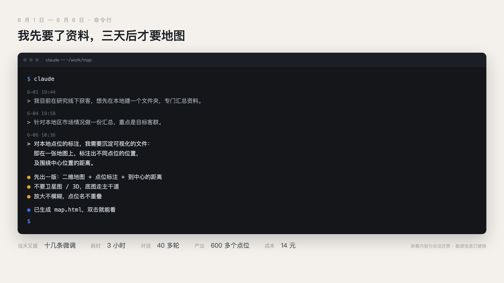
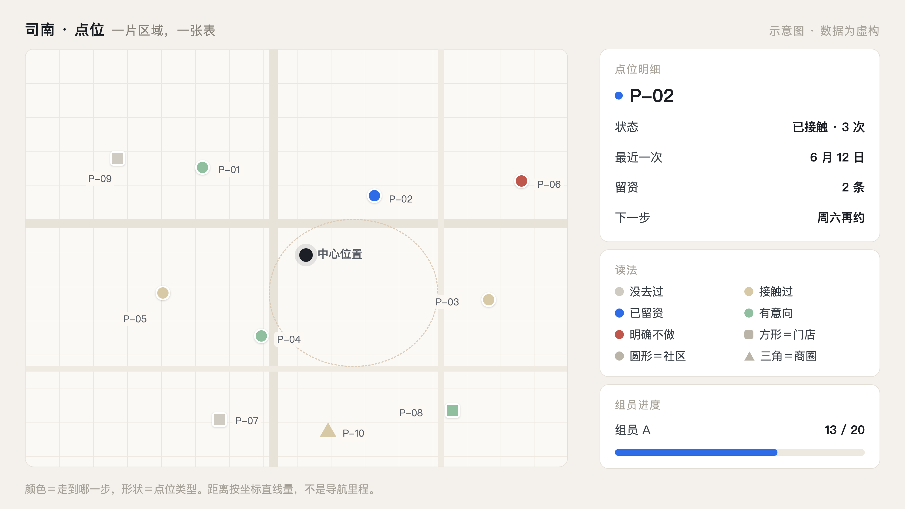
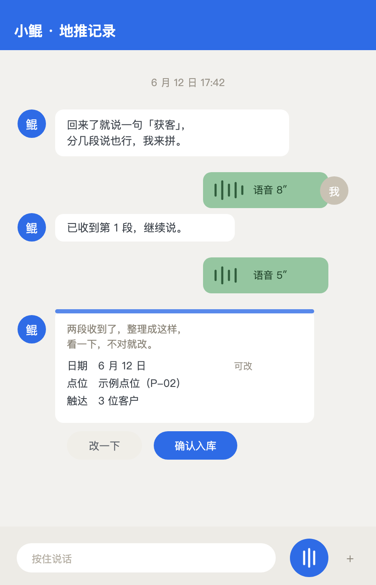
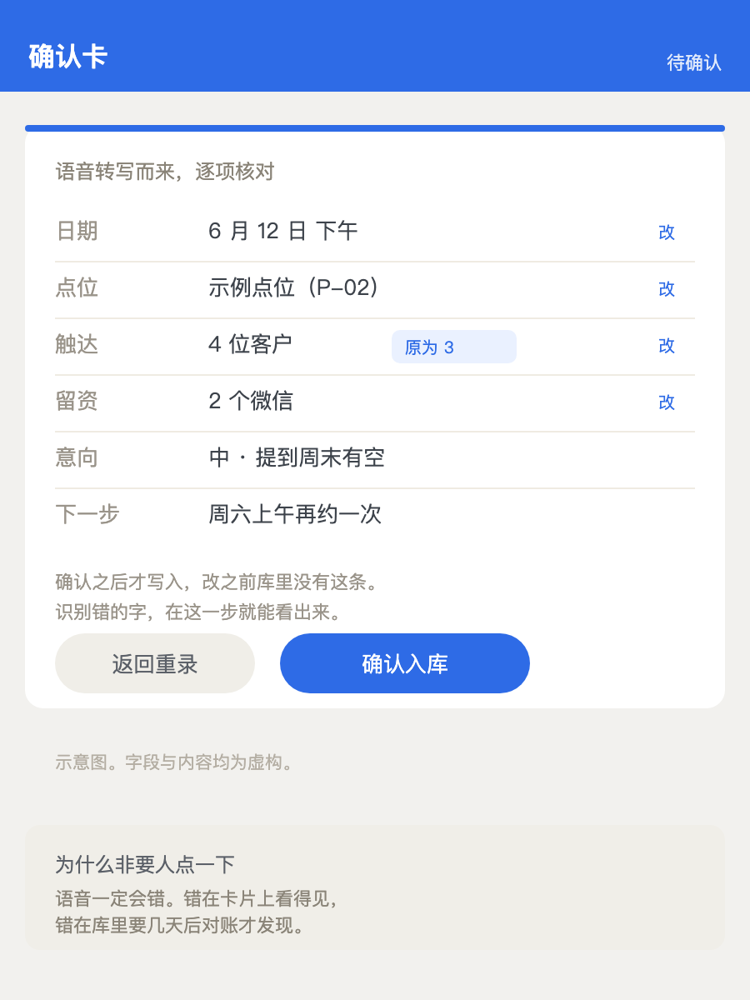
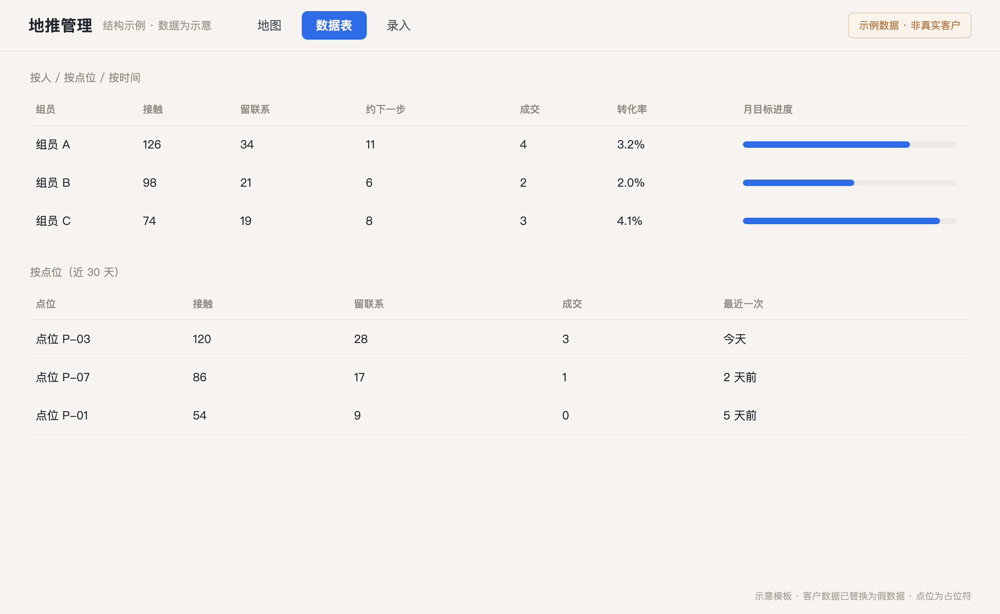
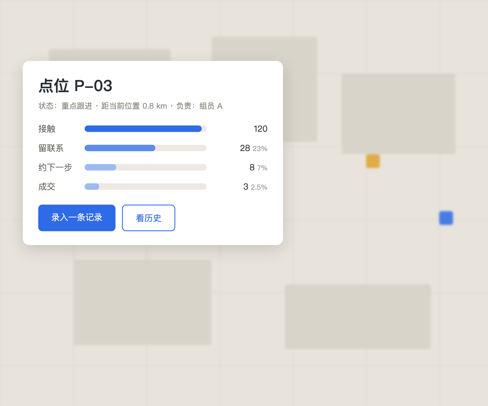
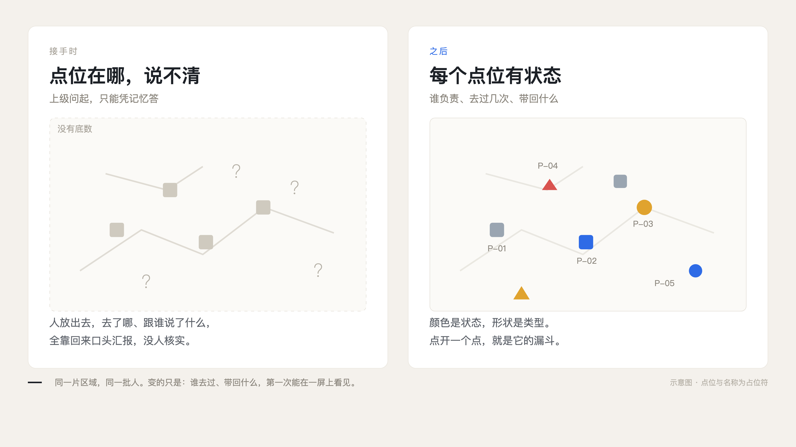

# 把管理意图做成能跑的形状

一个基层业务管理者，用 AI 把一支散掉的地推团队拉回正轨的过程记录，以及从里面抽出来的骨架。

我不是程序员，也不是产品经理，一行代码都不会写。三个月里没有技术支持，没有开发预算，只用了 AI 工具和一台 Mac。

这份仓库不是"我怎么用 AI 做了个系统"。它是三个决策的复盘：当时手里有什么事实、在权衡什么、定了什么、后来证明对还是错。每节末尾留一件可以拿走的东西。



---

## 决策一：先解决"去哪"，不解决"说什么"

**当时的事实。** 加入团队第一天，团队处在三种缺失里：过程记录不清晰（谁出门、去哪、跟谁说了什么，全靠口头汇报且不核实）；没有能力建设（没有培训、没有规则、没有评估）；没有复盘依据（开会凭感觉，两个关键指标被集体规避）。

一周后我和上级沟通区域情况，听到一句牢骚：我都不知道你说的区位在哪，这地方连张像样的地图都没有。

**在权衡什么。** 手上有两个可以动的地方：点位和话术。点位是业务结构，定下来能一直用；话术在人身上，人换了话术就废。而我手里最缺的是点位，不知道该把有限的人放在哪。

**定了什么。** 先做一张地图。第一次跟 AI 提要求只用了一段话，四十多个字，说清三件事：做什么、给谁看、边界在哪。3 小时后，600 多个点位落在一张可缩放的地图上，成本 14 元。第二个 3 小时，加上人员、区域、带回情况，它变成了一份地推管理系统，两天迭代 11 版。

**后来对不对。** 对。判断依据不是地图好看，是团队开会第一次有了能指的东西。上级再问「区位在哪」，我能把屏幕转过去。

**可以拿走的。** `prompts/01-建图.md`：把"我要什么"写到 AI 能照做的程度的那份模板。三个必填——范围、字段、验收标准。少一个，出来的东西必然返工。



## 决策二：让信息当天回来，而不是晚上补录

**当时的事实。** 地图上线两周，资料量超过以往一年，但有人开始用数量掩盖质量：没有姓名、只有电话，电话还是错的。我自己带的组能看到问题，看不到的组只能靠口述，信息打了折扣。

**在权衡什么。** 加考核能压出数量，压不出真实。压不出真实的数据，后面所有的量化都是空的。我找了三个人聊，问出三个卡点：现场不能当着客户面记录（短时记忆不够）、情景与意愿无法复述（决定跟进优先级）、2 到 3 小时内是跟进窗口（信息不完整就不敢开口）。

**定了什么。** 把录入搬到现场：对着手机说几段话，系统拼成一条记录，摆成一张确认卡，字段逐项可改、改动标"原为几"，人点确认才入库。

**后来对不对。** 对，但代价是必须留人这一步。语音一定会错，错在卡片上人一眼看得出，错在库里要几天后对账才发现。省掉确认这一步，这套东西就会以更快的速度产生错数据。

**可以拿走的。** `skills/02-打回来什么/SKILL.md` 与 `scripts/ingest_note.py`：一条口述变成结构化记录的最小实现，含字段契约与"不确认不写"的闸门位置。





## 决策三：先用骨架跑起来，不做系统

**当时的事实。** 两个月后屏上能同时回答四件事：谁去了哪、带回什么、结果值多少、对后面动作有什么影响。前两条是记录，后两条是判断。多数工具停在第二条。

**在权衡什么。** 再往前一步是做一个真正的系统：多人协作、权限、移动端适配、消息推送。这需要技术团队和预算，而这两样我都没有。更关键的是，当时还不确定这套东西能不能在另一个团队活下来。

**定了什么。** 不做系统，做骨架。把三层结构（点位层、记录层、判断层）拆成字段契约、三个技能说明、几个能本地跑的脚本、三份提示词。别人下载后接自己的数据源，不需要我的任何东西。

**后来对不对。** 部分对。骨架证明了思路可以移植，但它不能替你解决最难的一段：让人愿意开口。工具只能让愿意干的人少费点力，让不愿意干的人藏不住。

**可以拿走的。** 就是这份仓库，目录在下面。





---

## 这套骨架给什么，不给什么

**给：**

- `docs/数据与边界.md`：点位表、记录表的字段契约，状态词表，坐标系约定。字段不对，后面全歪。
- `skills/`：三段技能的说明，往哪打、打回来什么、打得怎么样。每段都写了"什么时候不该用"。
- `scripts/`：漏斗统计、点位表校验、静态地图生成、口述归整。全部本地跑，不依赖外部服务。
- `prompts/`：三份提示词。提示词可以抄，判断不能。

**不给：**

- 不给点位数据。点位是各地方的方言，我这一片的名字换到别的城市没有意义。
- 不给密钥，不给具体的数据获取实现。数据从哪来，每个地方每个行业都不一样，你自己接，脚本里留了接口位置。
- 不给客户资料。一个字都不给，示例全是占位符。

## 目录

```
README.md              这份文件：三个决策 + 骨架说明
docs/
  01-起点与地图.md      完整记录（一）：问题、一句牢骚、第一版
  02-记录与确认.md      完整记录（二）：滥竽充数、三个卡点、确认卡
  03-骨架与边界.md      完整记录（三）：三层结构、AI 的四个位置
  数据与边界.md         字段契约、状态词表、坐标系、什么不进仓库
skills/
  01-往哪打/SKILL.md     点位与优先级
  02-打回来什么/SKILL.md 现场录入与确认
  03-打得怎么样/SKILL.md 漏斗与周对照
scripts/
  points_schema.py     点位表校验
  funnel.py            漏斗统计（按点位、按人）
  build_map.py         点位表 → 本地 HTML 图（不接底图）
  ingest_note.py       一条口述 → 一条结构化记录
prompts/
  01-建图.md            把要求写到 AI 能照做
  02-归整记录.md        口述转 JSON 的系统提示
  03-周对照.md          周复盘对照
samples/
  points.example.csv   虚构点位表
  notes.example.json   虚构记录表
assets/                示意图（全部重绘，非真机截图）
```

## 怎么跑

需要 Python 3.9 以上，不需要装任何第三方库。

```bash
# 1 校验并看一眼自己的点位表
python3 scripts/points_schema.py samples/points.example.csv

# 2 出漏斗（按点位、按人）
python3 scripts/funnel.py --points samples/points.example.csv \
                          --notes samples/notes.example.json

# 3 生成一张本地可打开的点位图（不含底图，底图自己接）
python3 scripts/build_map.py --points samples/points.example.csv --out map.html

# 4 一条口述变成一条结构化记录
python3 scripts/ingest_note.py "6月12日 点位P-02 聊了4个 加了2个微信 意向中 周六再约"
```

示例数据是虚构的，点位名用 `P-01` 这类占位符。换成你自己的表，字段按 `docs/数据与边界.md` 那一份保持就行。



## 四个坑，先看再上手

1. **它会错，而且错得很像对的。** 语音识别必错，任何没有人工过一遍的自动归类都不要直接进判断。
2. **它不替你判断。** 它能告诉你某点位去了五次没有进展，不告诉你该不该放弃。
3. **它治不了风气。** 这件事里最难的是让人愿意开口，不是做工具。
4. **它会让你显得很能干，也很容易被误会。** 有人说我背后有团队。这个误会说明这套能力以前有门槛，现在门槛低了。

## 说明

仓库里的图全部是结构复刻的示意图，不是真机截图；示例数据、点位名、客户信息均为虚构。正文里的数字来自当时的操作记录，口径写在各处：对话轮次与时长按当时记录，费用是一次性的用量费。

## 许可

文档与脚本可自由取用、修改。用到自己的业务上，风险与合规自行判断。
